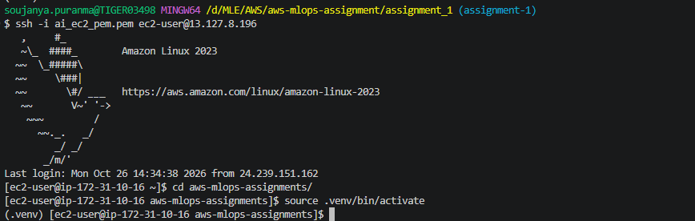
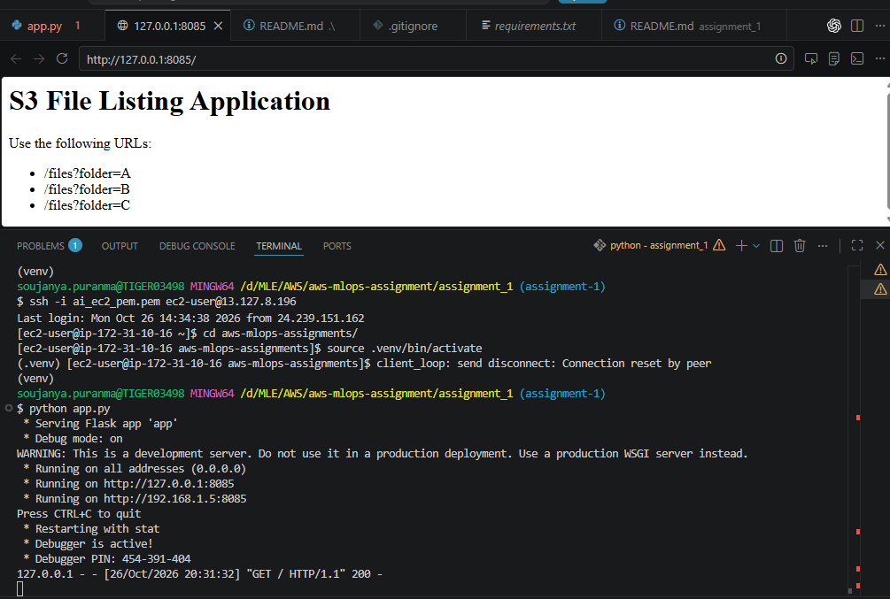
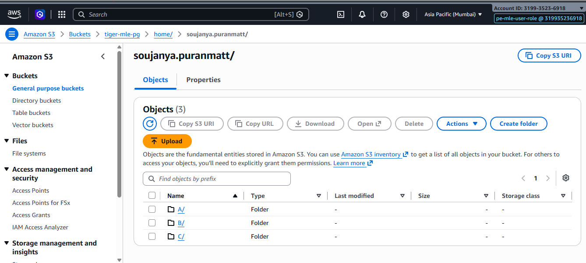
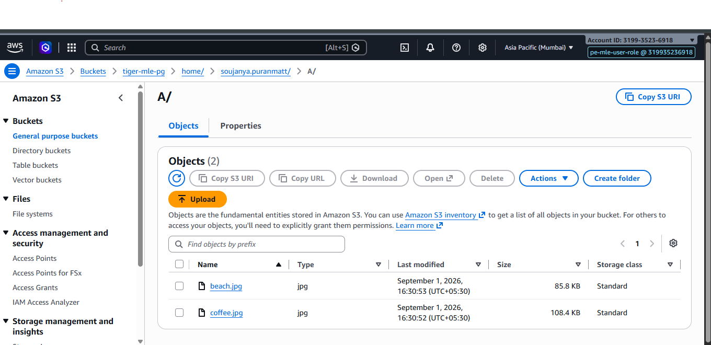

# Assignment 1: Flask App to List S3 Files

## Objective

Build and deploy a Flask web application that lists filenames from folders in an Amazon S3 bucket using Python and Boto3.

## Architecture

- **S3 bucket:** `tiger-mle-pg`
- **S3 region:** `ap-south-1`
- **S3 prefix:** `home/soujanya.puranmatt/`
- **EC2 instance type:** `t3.micro`
- **Application port:** `8085`
- **Application server:** Gunicorn

## S3 Folder Structure

```text
s3://tiger-mle-pg/home/soujanya.puranmatt/
├── A/
├── B/
└── C/
```

Each folder contains test files. The Flask app lists the files in the selected folder using Boto3.

## Prerequisites

- Python 3
- AWS CLI
- AWS credentials or an approved AWS CLI profile for local testing
- An S3 bucket with test files
- An EC2 instance with an IAM role allowing the required S3 listing operation

## Local Setup

1. Create and activate a Python virtual environment.
2. Install dependencies:

   `pip install -r requirements.txt`

3. Configure AWS credentials using an approved profile.
4. Start the app:

   `python app.py`

5. Open `http://127.0.0.1:8085/files?folder=A`.

## API Endpoints

| Endpoint | Description |
|---|---|
| `/` | Application status |
| `/files?folder=A` | List files in folder A |
| `/files?folder=B` | List files in folder B |
| `/files?folder=C` | List files in folder C |

Invalid folder names return HTTP 400.

## EC2 Deployment

1. Launch a `t3.micro` instance in `ap-south-1`.
2. Attach an IAM instance role with least-privilege S3 permissions.
3. Configure inbound access for TCP port 8085.
4. Install Python and the project dependencies.
5. Start Gunicorn:

   `gunicorn --bind 0.0.0.0:8085 app:app`

6. Open `http://13.127.8.196:8085/files?folder=A`.


## Screenshots

Add actual screenshots of:

1. S3 bucket and folders A, B and C.
2. Files uploaded to each folder.
3. Flask application running locally.
4. Successful API responses for folders A, B and C.
5. EC2 instance configuration and tags.
6. Security group configuration.
7. IAM role attached to EC2.
8. Application accessible through the EC2 public IP on port 8085.
9. GitHub pull request and reviewer approval.

## Screenshots

### 1. Connecting to EC2 using SSH



### 2. Local run



### 3. S3 Bucket Structure



### 4. S3 File Listings



### 5. App output from EC2


